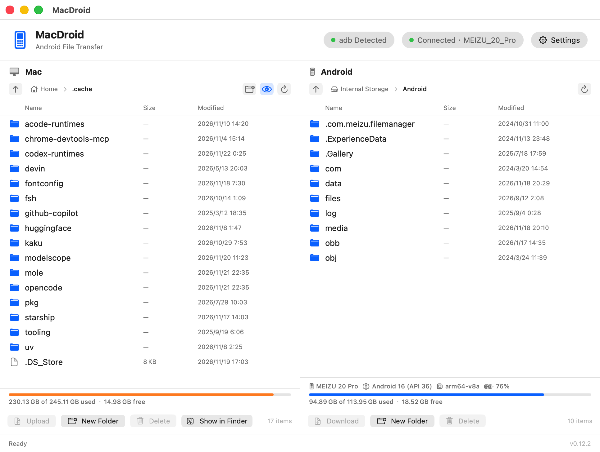

# MacDroid

A lightweight file transfer tool for macOS that lets you browse, copy, and manage files between your Mac and Android device over ADB — no full Xcode install required.

## Features

- Browse and transfer files between Mac and Android device
- Multi-language UI (English, Chinese, Japanese, Korean, German, Spanish, French)
- Native macOS app, Universal binary (Apple Silicon + Intel)
- Requires only Xcode Command Line Tools to build

## Requirements

- macOS 14.0 or later
- [ADB](https://developer.android.com/tools/releases/platform-tools) installed and available in `PATH`
- USB debugging enabled on your Android device

## Build & Run

```bash
cd MacDroid
./build.sh
```

This produces `MacDroid.app` as a Universal binary (arm64 + x86_64), ad-hoc signed.

Launch it directly or move it to `/Applications`.

## Usage

1. Connect your Android device via USB and enable file transfer mode.
2. Launch MacDroid — your device should appear automatically.
3. Browse the file tree and drag files between the two panes to transfer.

## Screenshot



## Troubleshooting

**"MacDroid is damaged and can't be opened"** — This happens when the app is copied or downloaded from outside the build machine: macOS adds a quarantine flag that ad-hoc signed apps don't satisfy. Remove it with:

```bash
xattr -cr /Applications/MacDroid.app
```

The `xattr -cr` step is already built into `build.sh`, so if you compiled the app yourself, it opens without this extra command.